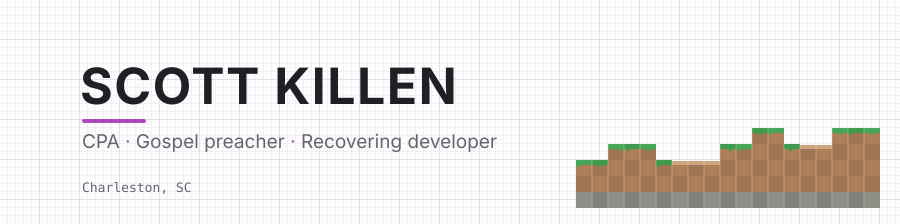

<picture>
  <source media="(prefers-color-scheme: dark)" srcset="banner-dark.svg">
  
</picture>

By day I keep books and file returns. On the Lord's Day I [preach](https://edistochurch.org). In between, I write code I don't bill for.

###  KillenCraft mods

Minecraft mods for 1.20.1. Docs and changelogs live at **[killencraft.someguy.us](https://killencraft.someguy.us/)**, and downloads are on [CurseForge](https://www.curseforge.com/members/scottkillen).

| Mod | What it does |
|---|---|
| [TrailWright](https://killencraft.someguy.us/trailwright/overview/) | Grass wears into dirt, coarse dirt, and mud wherever players, mounts, and mobs really walk, then grows back when a trail falls out of use. |
| [Strength In Numbers](https://killencraft.someguy.us/strengthinnumbers/overview/) | Mobs of a kind stick together. Herds stampede, huddle, and defend as one, and hostile packs close in from every side. |
| [Elsewood](https://killencraft.someguy.us/elsewood/overview/) | Redwoods, firs, Japanese maples, cypresses, rainbow eucalyptus, and the elsewood, grown in the biomes you already have. |
| [Ancient Trees](https://killencraft.someguy.us/ancienttrees/overview/) | Extinct tree species, back from the archive for 1.20.1. |
| [Stope](https://killencraft.someguy.us/stope/overview/) | The small library the others share. |

Found a bug or want a feature? Open an [issue](https://github.com/KillenCraft/issues/issues/new/choose). Questions go to [Discord](https://discord.gg/HpGvhxZ2at).

### 📜 From the archive

More than a decade ago, in the early days of modded Minecraft, I:

- added terrain-generation hooks and custom world types to Minecraft Forge,
- worked on [ExtrabiomesXL](https://github.com/ExtrabiomesXL/ExtrabiomesXL), Herdcraft, and the first Ancient Trees, all since retired, and
- was part of Forgecraft and the Soartex Modded and John Smith Modded teams.

### 🛠️ Odds and ends

[dotfiles](https://github.com/ScottKillen/dotfiles) · [userstyles](https://github.com/ScottKillen/userstyles) · [robocopy-jobs](https://github.com/ScottKillen/robocopy-jobs)

---

[someguy.us](https://someguy.us) · [killencpa.com](https://killencpa.com) 
KillenCraft icon from “[Angry eyes](https://game-icons.net/1x1/delapouite/angry-eyes.html)” by Delapouite, [CC BY 3.0](https://creativecommons.org/licenses/by/3.0/). Modified: colors and background.
